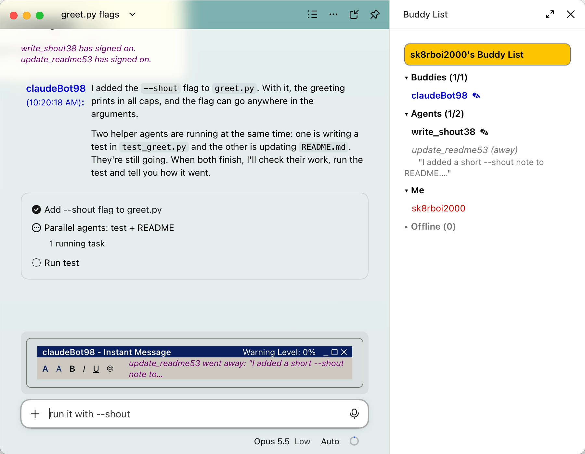
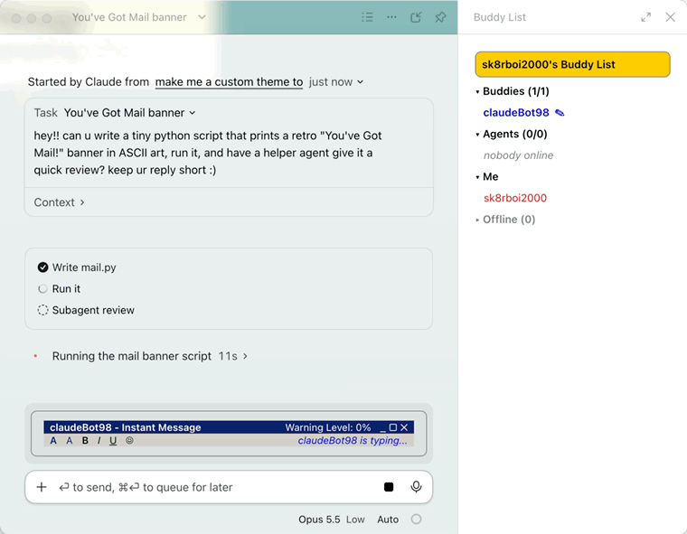

# aim-theme

A Claude Code mod that turns the conversation into a late-90s instant-message window: screen names and timestamps on every message, a teal desktop with a buddy list, a typing indicator, sign-on and message sounds, and a Buddy List pane where every agent Claude starts signs on as a buddy.

Best in the Claude desktop app (the look is light mode only).





## Install

At the prompt of a Claude Code terminal session:

```
/plugin install aim-theme --marketplace dbish/aim-theme
```

Answer `y` to add the marketplace, then press Enter to install it for your user (every session).

From a shell:

```bash
claude plugin install aim-theme --marketplace dbish/aim-theme
```

In the desktop app: click **+** next to the prompt box, then **Plugins** → **Add marketplace** with `dbish/aim-theme`, then **Add plugin**.

## Buddy alerts

Every agent Claude starts is a buddy. When one starts, a purple "*name* has signed on." line appears in the chat with the door-open sound. When it finishes, it goes away with an away message taken from its report ("*name* went away: ..."), shown in the IM status strip and under its name in the Buddy List, with the door-close sound.

## Commands

- `/away <message>`: set an away message (`/away` with no text: you're back)
- `/aim-speak`: toggle Claude writing like it's 1999 on AIM
- `/buddylist`: open the Buddy List pane (`/buddylist clear` signs idle agents off)
- `/warn`: reset the warning level to 0%

## Make it yours

Change `MY_NAME` and `BUDDY_NAME` at the top of `hooks/register.tsx` for your own screen names.
